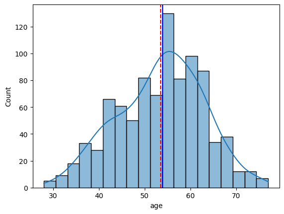
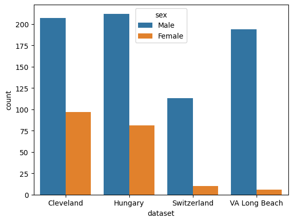
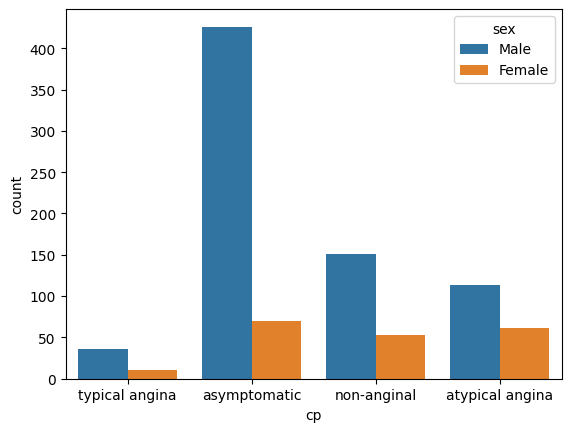
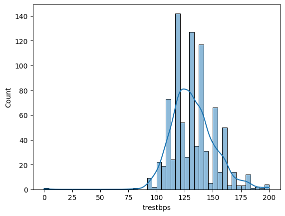
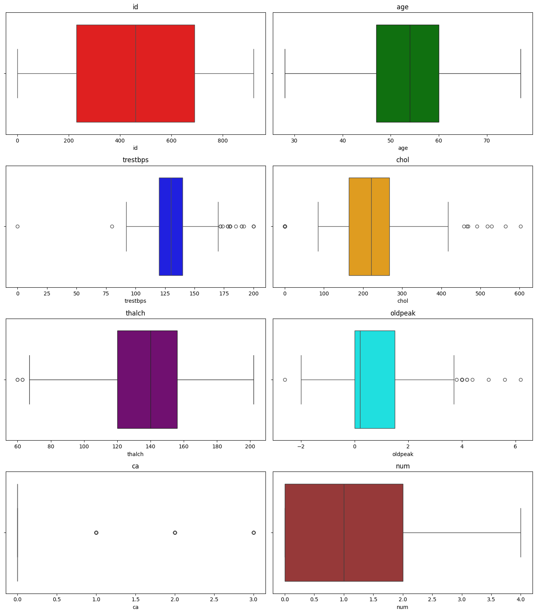

# Heart Disease Prediction (Multi-Class Classification)

A machine learning and exploratory data analysis (EDA) project using the **UCI Heart Disease dataset** (`heart_disease_uci.csv`, 920 patient records across 4 clinical cohorts) to predict heart disease severity across 5 classes (`0` = no heart disease through `4` = severe heart disease).

---

## Overview

This project walks through end-to-end clinical tabular data analysis and multi-class classification:

- **Dataset Coverage:** 920 records and 16 columns combining Cleveland (`304`), Hungary (`293`), VA Long Beach (`200`), and Switzerland (`123`) cohorts.
- **Exploratory Data Analysis (EDA):** Age distribution (`28`–`77` years, mean `53.51`), sex distribution (`78.91%` Male, `21.09%` Female), chest pain (`cp`) breakdown, and resting blood pressure (`trestbps`) profiling.
- **Missing Value Imputation:** Custom iterative/Random-Forest-style imputation pipeline for categorical (`thal`, `ca`, `slope`, `exang`, `restecg`, `fbs`) and numeric (`trestbps`, `chol`, `thalch`, `oldpeak`) features.
- **Outlier Handling:** Boxplot inspection across numeric attributes and removal of invalid `trestbps == 0` record (`919` clean rows remaining).
- **Multi-Class Model Benchmarking:** Cross-validation and held-out test evaluation across **9 classifiers** inside `scikit-learn` `Pipeline` + `ColumnTransformer` workflows.

---

## Genuine Notebook Visual Outputs

The figures below were extracted directly from saved execution outputs in `heart_desease_project.ipynb`:

| Age Distribution & Summary Statistics | Dataset Cohort Breakdown by Sex |
| :---: | :---: |
|  |  |

| Chest Pain Type by Sex | Resting Blood Pressure (`trestbps`) |
| :---: | :---: |
|  |  |

| Numeric Feature Outlier Boxplots |
| :---: |
|  |

---

## Recorded Benchmark Results (from Saved Notebook Output)

Target column `num` (`0`: 411, `1`: 265, `2`: 109, `3`: 106, `4`: 28 after outlier filtering):

| Model | Cross-Validation Accuracy | Test Accuracy |
| :--- | :---: | :---: |
| **XGBoost (`XG Boost`)** | 0.6159 | **0.6377** |
| **Gradient Boosting** | 0.6268 | 0.6341 |
| **Random Forest** | **0.6329** | 0.6159 |
| **AdaBoost** | 0.6299 | 0.6051 |
| **Support Vector Machine (SVM)** | 0.5988 | 0.5942 |
| **Logistic Regression** | 0.6191 | 0.5870 |
| **K-Nearest Neighbors (KNN)** | 0.5692 | 0.5761 |
| **Decision Tree** | 0.5926 | 0.5616 |
| **Gaussian Naive Bayes** | 0.3780 | 0.3551 |

> In the recorded run, **XGBoost** achieved the highest test accuracy (`63.77%`) and was exported as `best_model.pkl` (not committed to the repository).

---

## Project Structure

```text
heart-disease-prediction/
├── heart_desease_project.ipynb   # Main EDA, imputation, and 9-model benchmark notebook
├── heart_disease_uci.csv         # Local UCI Heart Disease dataset (920 rows, 16 columns)
├── screenshots/                  # Genuine matplotlib/seaborn plots extracted from notebook outputs
├── requirements.txt              # Python dependencies
├── .gitignore
└── README.md
```

---

## Installation & Local Execution

1. **Clone the repository**
   ```bash
   git clone https://github.com/ahmadtanoli2004/heart-disease-prediction.git
   cd heart-disease-prediction
   ```

2. **Create a virtual environment and install dependencies**
   ```bash
   python -m venv .venv
   # Windows: .venv\Scripts\activate
   # macOS/Linux: source .venv/bin/activate
   pip install -r requirements.txt
   ```

3. **Launch Jupyter and run the notebook**
   ```bash
   jupyter notebook heart_desease_project.ipynb
   ```
   > `heart_disease_uci.csv` is included in the repository root alongside `heart_desease_project.ipynb`, so the notebook loads it directly with `pd.read_csv('heart_disease_uci.csv')`.

---

## Notes & Known Limitations

- The final markdown summary cell (`Outputs`) in the original notebook still contains a few template observation placeholders (`items 8–13`).
- `best_model.pkl` is generated at runtime when executing Cell 51 and is excluded via `.gitignore`.
